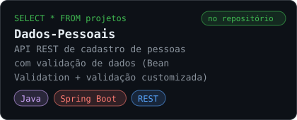

### `-- 01` sobre

Estagiário de **People Analytics** no **A.C.Camargo Cancer Center**, onde transformo dados de RH em relatórios e dashboards que apoiam decisões sobre pessoas. Curso **Análise e Desenvolvimento de Sistemas no Senac** e estou construindo minha carreira em **dados** — com interesse em análise, engenharia e ciência de dados.

### `-- 02` stack

### `-- 03` trajetória

### `-- 04` projetos

<b>versão em texto</b> (para leitura rápida)

 

**Eduardo Mendonça** — São Paulo, SP

**Experiência**
- **Estagiário de People Analytics** — A.C.Camargo Cancer Center (abr/2026 – atual)
  - Extração e tratamento de dados de RH com SQL
  - Criação e manutenção de dashboards no Power BI para indicadores de pessoas
  - Relatórios em Excel para apoio às áreas de gestão
  - Organização e padronização de bases de dados (ETL)

**Formação**
- Análise e Desenvolvimento de Sistemas — Senac (em andamento)

**Certificações**
- Database Foundations e Database Programming with SQL — Oracle Database Academy
- Intensivão de Power BI — Hashtag Treinamentos
- Introdução a Banco de Dados SQL — Udemy
- Minicurso de Power BI — Xperiun
- Excel Intermediário — Fundação Bradesco

**Competências**
SQL · Oracle Database · Power BI · Excel · ETL · Modelagem de Dados · Visualização de Dados · Python (em estudo) · Java · Spring Boot · Git

**Projetos**
- [Dados-Pessoais](https://github.com/EduardoMendonca2709/Dados-Pessoais) — API REST de cadastro de pessoas com validação (Java, Spring Boot)

