<a href="https://www.linkedin.com/in/eduardosantosmendonca/">
  <picture>
    <source media="(prefers-color-scheme: dark)" srcset="./assets/header-dark.svg">
    
  </picture>
</a>

  <a href="https://www.linkedin.com/in/eduardosantosmendonca/"><picture><source media="(prefers-color-scheme: dark)" srcset="./assets/btn-linkedin-dark.svg"></picture></a>
  <a href="https://github.com/EduardoMendonca2709?tab=repositories"><picture><source media="(prefers-color-scheme: dark)" srcset="./assets/btn-repos-dark.svg"></picture></a>

Estagiário de **People Analytics** no **A.C.Camargo Cancer Center** e estudante de **Análise e Desenvolvimento de Sistemas no Senac SP**, em busca de **estágio em Ciência de Dados**. No dia a dia, uso **SQL**, **Power BI** e **Excel** para transformar dados de RH em relatórios e dashboards que apoiam decisões sobre pessoas. Por fora, estudo **Python** para análise de dados.

### Stack

<picture>
  <source media="(prefers-color-scheme: dark)" srcset="./assets/stack-dark.svg">
  
</picture>

### Trajetória

<picture>
  <source media="(prefers-color-scheme: dark)" srcset="./assets/trajetoria-dark.svg">
  
</picture>

### Projetos

<a href="https://github.com/EduardoMendonca2709/Dados-Pessoais">
  <picture>
    <source media="(prefers-color-scheme: dark)" srcset="./assets/projetos-dark.svg">
    
  </picture>
</a>

<b>versão em texto</b> (para leitura rápida)

 

**Eduardo Mendonça** — São Paulo, SP

**Objetivo:** estágio em Ciência de Dados (também aberto a Análise e Engenharia de Dados)

**Experiência**
- **Estagiário de People Analytics** — A.C.Camargo Cancer Center (abr/2026 – atual)
  - Extração, tratamento e análise de dados de RH com SQL
  - Criação e manutenção de dashboards no Power BI para indicadores de pessoas (KPIs)
  - Relatórios e análises em Excel (tabelas dinâmicas e fórmulas) para as áreas de gestão
  - Organização, limpeza e padronização de bases de dados (ETL)
- **Jovem aprendiz** — Cafeteria (jul/2023 – dez/2024)
  - Desenvolvimento de relatórios e organização de procedimentos

**Formação**
- Análise e Desenvolvimento de Sistemas — Senac São Paulo (jul/2025 – dez/2027)

**Certificações**
- Database Foundations e Database Programming with SQL — Oracle Database Academy
- Intensivão de Power BI — Hashtag Treinamentos
- Introdução a Banco de Dados SQL — Udemy
- Minicurso de Power BI — Xperiun
- Excel Intermediário — Fundação Bradesco

**Competências**
SQL · Oracle Database · Power BI · Excel · ETL · Modelagem de Dados · Visualização de Dados · KPIs · Python (em estudo) · Git

**Projetos**
- [Dados-Pessoais](https://github.com/EduardoMendonca2709/Dados-Pessoais) — API REST de cadastro de pessoas com validação (Java, Spring Boot)

<picture>
  <source media="(prefers-color-scheme: dark)" srcset="./assets/footer-dark.svg">
  
</picture>

Aberto a feedback e a conversas sobre dados. Se quiser falar comigo, me chame no LinkedIn.
